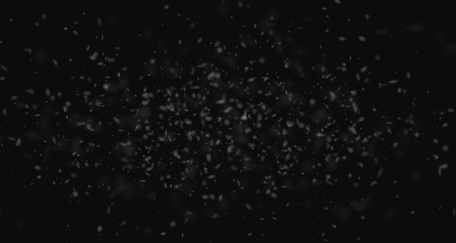
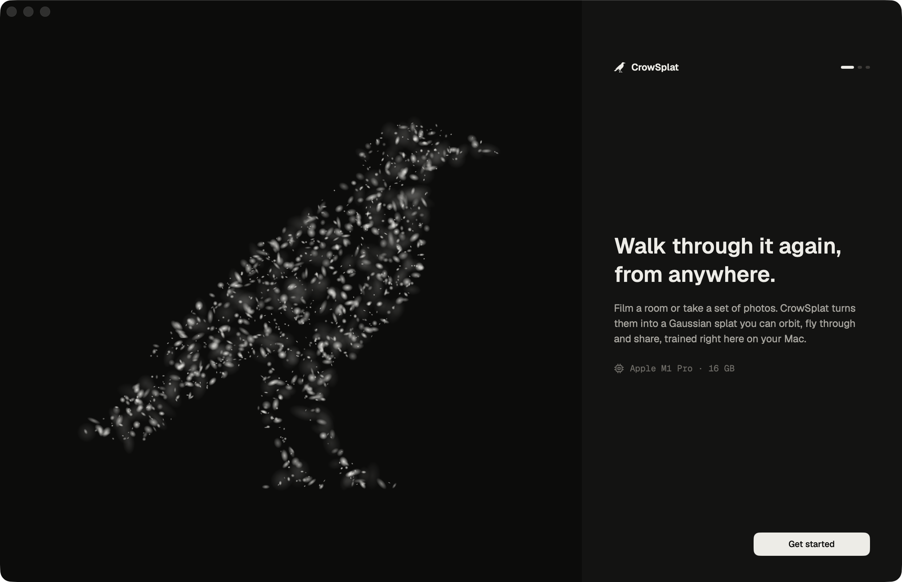
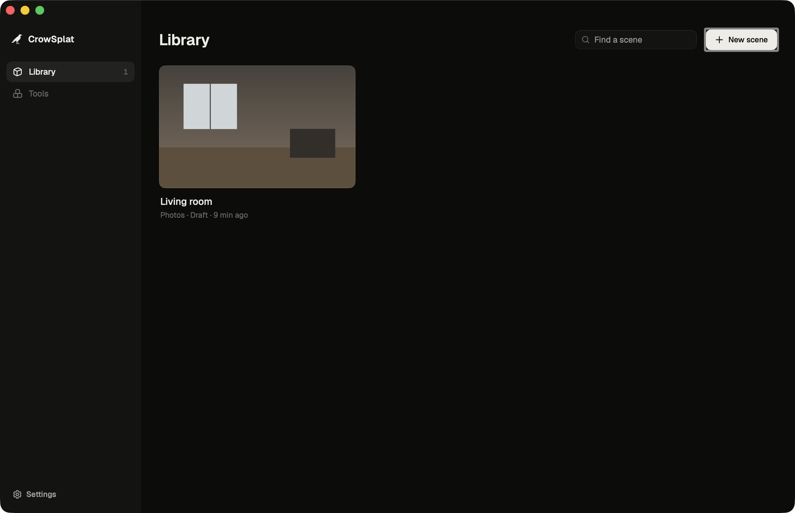

<p align="center">
  
</p>

<h1 align="center">CrowSplat</h1>

<p align="center">
  Film a room. Walk through it again, from anywhere.<br>
  A native Mac app that turns a video or a set of photos into a Gaussian splat, trained on your own machine.
</p>

<p align="center">
  
  
  
  
</p>

---

CrowSplat is a ground-up frontend for [CorbeauSplat](https://github.com/freddewitt/CorbeauSplat), Frederick's open-source Gaussian splatting pipeline for the Mac. The engines underneath are his: COLMAP for camera poses, Brush for training, cleaning and export. CrowSplat replaces the Qt interface with a SwiftUI app and redesigns the whole flow around one question: *what did you capture?*

<p align="center">
  
</p>

## What it does

**Drop a capture, get a scene.** Drag one video or a folder of photos anywhere into the window. CrowSplat shows what it understood (the video with a poster frame and an in/out range, or a strip of your photos spread across the whole walk) and asks only what changes the result: how much detail, whether to remove floaters, which formats to export. One choice of *Draft, Standard* or *Fine* replaces forty training parameters.

**Watch it take shape.** While Brush trains, every checkpoint it writes loads into the viewer, so the splat sharpens in front of you. Progress is read live from the tools' own output: COLMAP image by image, Brush step by step with the time left and the current splat count. The Dock icon carries the progress too, and a notification arrives when a long run ends.

**A library, not a project folder.** Every scene is a plain folder holding the splat, its exports, the frames it came from and a `scene.json` the app reads. Move it, back it up, open it anywhere. Interrupted runs say so and start again with one click.

**Tools on the side.** Single photo to 3D with Apple ML Sharp, cleaning, conversion to SOG, SPZ and GLB, upscaling, 360° video splitting and 4D dataset preparation, each as one input, a few choices and a run.

<p align="center">
  
</p>

## Design

The brief was a fixed design language, white on black, with the crow as the mark, and nothing that looks generated.

- **The signature is the subject.** The crow is drawn the way the app draws everything: as about 1,500 soft, anisotropic Gaussians sampled inside the logo's outline. They drift in as a cloud, settle into the silhouette, breathe and part around the pointer. The same field is the onboarding hero, the empty library, the waiting state of a scene and the app icon, all rendered from one Swift file.
- **One palette, no brand hue.** Off-white ink on a near-black that leans warm, never blue. Emphasis is tonal, a step lighter or darker. The only colour in the app is a muted brick, and only for failure.
- **Surfaces without lines.** Panels lift off the canvas by tone and a self-coloured edge with a faint top lip, the way light catches a rounded rim. No drop shadows. Glass is used once, for the camera controls, where there is a live 3D scene behind it to refract.
- **Type and icons.** Geist throughout, Geist Mono only for data (step counts, durations, paths). Icons from [Gravity UI](https://gravity-ui.com/icons), a complete and rarely seen set on a 16 px grid, always bare, never in a tile.
- **Motion that means something.** Springs over curves, so interrupted animations keep their velocity. Progress bars grow by width with stable caps and glide between updates instead of jumping. Nothing waits on an animation to become visible.

## Install

Download the DMG from [Releases](https://github.com/builtbymatti/CrowSplat/releases), open it and drag CrowSplat into Applications. On first launch it checks what your Mac has and installs the engines it needs:

| Engine | Needed for | Comes from |
| --- | --- | --- |
| COLMAP | every scene | Homebrew (`brew install colmap`) |
| Brush | every scene | downloaded by the app |
| SplatTransform | SOG / SPZ / GLB export | npm, needs [Node.js](https://nodejs.org) |
| ML Sharp, Upscayl, 360° Extractor, 4DGS prep | the matching tools | downloaded by the app, optional |

macOS 15 or later on Apple Silicon. 16 GB of memory is comfortable for room-sized scenes.

## Architecture

```
CrowSplat.app  (SwiftUI)
 ├─ Library · New scene · Scene · Tools · Settings
 ├─ Viewer      PlayCanvas SuperSplat viewer in a WKWebView, its own UI off,
 │              local splats streamed through a crow:// URL scheme
 └─ python -m app.bridge run job.json      one process per job
      └─ app/core    the CorbeauSplat engines, unchanged:
                     COLMAP · Brush · cleaner · export · Sharp · upscale · 360 · 4DGS
```

The release app carries its own relocatable CPython 3.13 and the core, without Qt: an 80 MB DMG where the original environment was 1.3 GB.

The bridge (`app/bridge`) is the only new layer in the core. It runs one job per process and writes one JSON event per line on stdout; everything the engines print goes to stderr as the raw log. SIGTERM cancels and stops the running engine, and so does the app disappearing mid-run.

| Event | Fields | Meaning |
| --- | --- | --- |
| `step` | `id`, `label`, `index`, `count`, `steps` | a stage begins |
| `progress` | `step`, `value` | 0 to 100 within the stage |
| `eta` | `step`, `seconds` | time left, -1 when unknown |
| `status` | `text` | a short live line ("image 12/40", "500,123 splats") |
| `log` | `text`, `level` | a line worth keeping |
| `artifact` | `kind`, `path` | a thumbnail, checkpoint, splat or export |
| `done` | `ok`, `message`, `result` | always last |

Live progress comes from parsing the tools' own output: COLMAP's per-image counters (with exhaustive matching weighted by image pairs), and Brush's progress bar, which Brush only draws on a terminal, so the core runs it on a pseudo-terminal. `tools/progress_demo` holds stand-ins for COLMAP and Brush that print the real formats and leave real files, so the whole chain runs end to end without a GPU.

## Build from source

```sh
brew install xcodegen uv create-dmg
python3 -m venv .venv && .venv/bin/pip install -r requirements.txt   # the core, for debug builds
python3 macos/scripts/sync_assets.py --viewer                       # icons, fonts, viewer (pinned)
cd macos && xcodegen generate && open CrowSplat.xcodeproj
```

Debug builds run the core straight from the checkout. `macos/scripts/build_release.sh` builds the release app with the embedded Python, signs every binary with the hardened runtime, makes the DMG and notarizes it when a `notarytool` profile named `crowsplat` exists.

```
app/bridge/         JSON job bridge (new)
app/core/           CorbeauSplat engines
macos/CrowSplat/    the SwiftUI app: App, Core, Design, Features
macos/scripts/      asset sync, brand renderer, release build
tools/progress_demo stand-in engines for GPU-free runs
docs/corbeausplat/  the original project's README, CLI guide and changelog
```

The original Qt app and CLI still run from this repository with `python main.py`; see [docs/corbeausplat](docs/corbeausplat/README.md).

## Credits

- [CorbeauSplat](https://github.com/freddewitt/CorbeauSplat) by Frederick, MIT
- [COLMAP](https://colmap.github.io), BSD
- [Brush](https://github.com/ArthurBrussee/brush) by Arthur Brussee, Apache-2.0
- [SuperSplat Viewer](https://github.com/playcanvas/supersplat-viewer) and [splat-transform](https://github.com/playcanvas/splat-transform) by PlayCanvas, MIT
- [Geist](https://vercel.com/font) by Vercel, SIL OFL 1.1
- [Gravity UI icons](https://gravity-ui.com/icons), MIT

## License

MIT, see [LICENSE](LICENSE). Designed and built by [Matti Schulz](https://github.com/builtbymatti).
